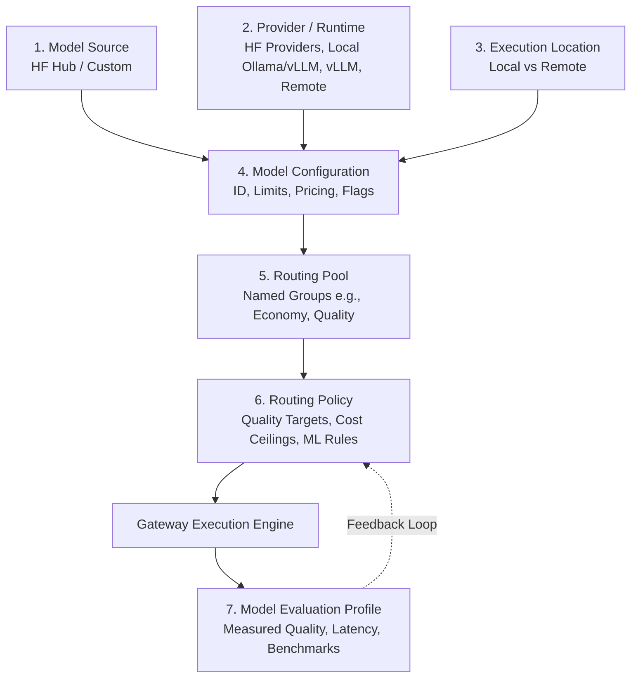
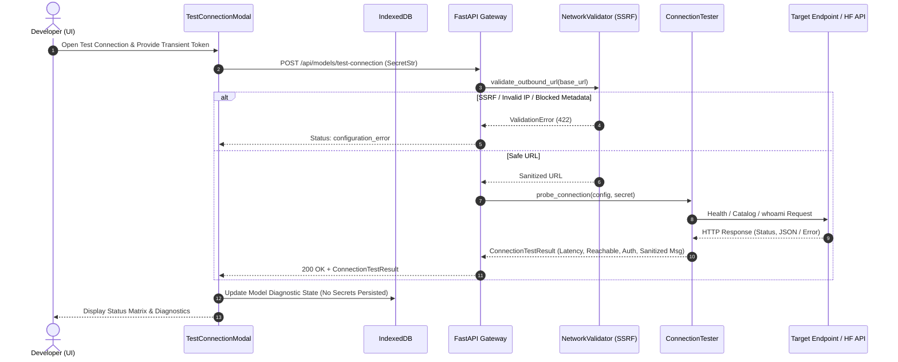

# TokenPilot Architecture Overview

TokenPilot is an intelligent, extensible ML-powered LLM gateway and developer platform designed to slash inference costs while preserving high response quality.

---

## 1. Core Architectural Separation

TokenPilot strictly isolates 7 core dimensions of LLM infrastructure. No component is coupled or assumed to imply another:



### Definitions:
1. **Model Source**: The origin or repository where the model definition lives (e.g., Hugging Face Hub repository `deepseek-ai/DeepSeek-R1-Distill-Qwen-1.5B` vs. a private organization repo or manual specification).
2. **Provider or Runtime**: The runtime service serving the model (Hugging Face Inference Providers, Hugging Face Dedicated Endpoints, Local OpenAI-compatible server like Ollama, llama.cpp, vLLM, or Remote OpenAI-compatible API).
3. **Execution Location**: Purely indicates physical locality (`local` or `remote`). Local execution does *not* automatically mean cheap/free (e.g., dedicated multi-GPU rigs), and remote does not automatically mean expensive.
4. **Model Configuration (`WorkspaceModel`)**: The specific instantiated configuration in a user's workspace—including base URL, provider model ID, context window, validated capabilities, input/output pricing, pricing source, and status.
5. **Routing Pool (`RoutingPool`)**: A dynamic, user-curated collection of models (many-to-many relationship via `PoolMembership`). Pools are not hardcoded; users can create arbitrary pools such as "Economy", "Quality", "Coding", or "Local Only".
6. **Routing Policy (`RoutingPolicy`)**: The set of hard constraints (cost ceilings, latency limits, location filters) and soft optimization objectives (predictive ML router score, quality target) evaluated per incoming prompt.
7. **Model Evaluation Profile (`ModelEvaluationProfile`)**: Empirical benchmark records and measured metrics (accuracy, win rates, latencies, failure rates) derived from reproducible evaluation runs, not fabricated claims.

---

## 2. High-Level System Architecture

```mermaid
flowchart LR
    subgraph Browser ["Frontend (React + Vite + TypeScript)"]
        UI["Developer UI<br/>(Studio, Playground, Routing, Analytics)"]
        Storage["Storage Abstraction<br/>(IWorkspaceRepository)"]
        IDB[("IndexedDB<br/>Local Persistence")]
        UI <--> Storage
        Storage <--> IDB
    end

    subgraph Backend ["FastAPI Gateway & Discovery"]
        API["REST API Router"]
        HFService["HF Hub Discovery Service"]
        Catalog["Verified Recommendations Catalog"]
        Validator["Schema Validation (Pydantic v2)"]
        API --> Validator
        API --> HFService
        API --> Catalog
    end

    subgraph External ["External Services & Runtimes"]
        HFHub["Hugging Face Hub API"]
        HFInf["Hugging Face Inference Providers"]
        LocalSrv["Local Runtimes (Ollama/vLLM)"]
        RemoteAPIs["Remote APIs (OpenAI format)"]
    end

    UI -->|REST / CORS| API
    HFService -->|HTTPS / Token (Optional)| HFHub
    UI -.->|Direct Gateway Call (Future M3)| LocalSrv
    UI -.->|Direct Gateway Call (Future M3)| HFInf
    UI -.->|Direct Gateway Call (Future M3)| RemoteAPIs
```

---

## 3. Storage and Repository Abstraction

To ensure local privacy and frictionless offline-first onboarding, nonsecret workspace state is stored locally on the client:

- **Storage Interface**: `IWorkspaceRepository` exposes asynchronous CRUD contracts:
  - `getWorkspaceModels()`, `saveWorkspaceModel()`, `deleteWorkspaceModel()`
  - `getRoutingPools()`, `saveRoutingPool()`, `deleteRoutingPool()`
  - `getPoolMemberships()`, `assignModelToPool()`, `removeModelFromPool()`
  - `getUsageEvents()`, `recordUsageEvent()`
- **Local Implementation**: `IndexedDBWorkspaceRepository` powered by IndexedDB.
- **Future Cloud Sync**: `CloudWorkspaceRepository` will implement the exact same interface to sync data to SQLite/PostgreSQL through FastAPI without refactoring UI components.
- **Zero-Secret Persistence**: API keys and tokens are **never** stored in IndexedDB or logs. Credentials are only held in volatile session memory during active execution or via local runtime proxies.

---

## 4. Hugging Face Hub Integration

- Uses backend service proxying the Hugging Face Hub API.
- Caches public discovery metadata to avoid rate-limiting.
- Gracefully handles offline or network-blocked environments with user retry options.
- Strictly flags verified properties (license, context length, gated model status) versus unverified claims.
- Never downloads large model weights during search or model configuration.

---

## 5. Model Connection Testing & Diagnostics Subsystem (M3.1)

Milestone M3.1 delivers pre-flight diagnostics and connection testing for user-configured models without initiating billable completion queries.



### Architectural Highlights:
- **Stateless Gateway Testing**: Works seamlessly with client-side IndexedDB persistence by accepting a nonsecret configuration payload and optional ephemeral token.
- **SSRF Defense-in-Depth**: All candidate outbound endpoints undergo hostname DNS resolution, link-local metadata filtering (`169.254.169.254`), and environment-controlled LAN filtering before HTTP dispatch.
- **Truthful Status Taxonomy**: Distinguishes `connected` (endpoint reachable and authenticated or catalog verified), `authentication_failed`, `unreachable`, `configuration_error`, and `unsupported` / inconclusive.
- **Inference Verification Separation**: Non-generative catalog or health queries do not claim `inference_verified=true`; verification flags represent empirical reality rather than speculative assumptions.

