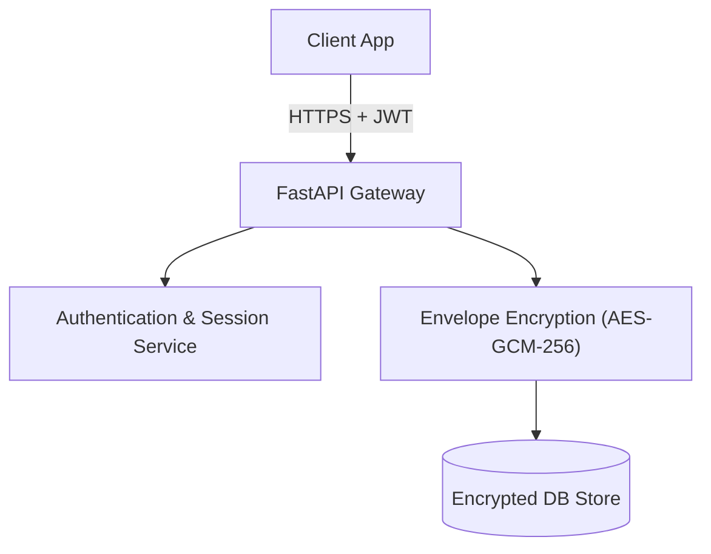

# Security & Credential Management Architecture

Security is central to TokenPilot. When managing AI infrastructure, credentials, tokens, and prompt telemetry must be protected against leakage and misuse.

---

## 1. Zero-Secret Local Storage Policy

### Core Rules for Milestone M0-M2:
1. **Never store plaintext API tokens in browser storage**: `localStorage`, `sessionStorage`, and `IndexedDB` must never hold provider keys (e.g. Hugging Face tokens, OpenAI keys, Groq keys).
2. **Volatile Session References Only**: If a user tests a connection, the credential may only reside in memory for that request cycle or via local OS environment variables.
3. **No Secrets in Logs**: All backend request logs must sanitize `Authorization: Bearer ***` and header tokens.
4. **No Secrets in Config Export**: Exporting workspace models or routing pools produces sanitized schemas stripped of authorization attributes.

---

## 2. Local-Only Privacy & Boundaries

- In the initial offline/local mode, workspace data is saved strictly inside the user's browser IndexedDB.
- **Limitation**: Local-only workspace does not automatically synchronize or recover across different browsers, private windows, or physical machines. This trade-off is accepted to avoid sending unencrypted user data to premature third-party servers.
- Hugging Face model discovery is read-only public metadata. TokenPilot does not transmit user model configurations to Hugging Face or any external telemetry service.

---

## 3. Future Cloud Synchronization & Credential Vault (Milestone M7)

When account-scoped cloud synchronization is added in Milestone M7:

- **Per-Tenant Encryption**: Master keys managed via environment KMS, encrypting individual credentials using user-specific salt and AES-256-GCM.
- **Key Revocation & Audit**: Audit log of when credentials were exchanged for upstream inference calls.
- **Data Export & Right to be Forgotten**: Endpoints allowing one-click JSON export of all workspace models, pools, and prompt metrics, or full irreversible purge.
