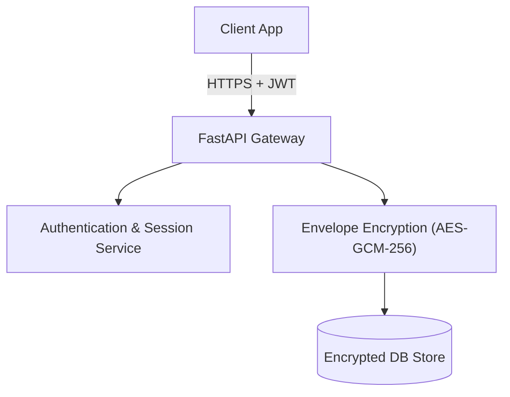

# Security & Credential Management Architecture

Security is central to TokenPilot. When managing AI infrastructure, credentials, tokens, and prompt telemetry must be protected against leakage and misuse.

---

## 1. Zero-Secret Local Storage Policy

### Core Rules for Milestone M0-M2:
1. **Never store plaintext API tokens in browser storage**: `localStorage`, `sessionStorage`, and `IndexedDB` must never hold provider keys (e.g. Hugging Face tokens, OpenAI keys, Groq keys).
2. **Volatile Session References Only**: If a user tests a connection, the credential may only reside in memory for that request cycle or via local OS environment variables.
3. **No Secrets in Logs**: All backend request logs must sanitize `Authorization: Bearer ***` and header tokens.
4. **No Secrets in Config Export**: Exporting workspace models or routing pools produces sanitized schemas stripped of authorization attributes.

---

## 2. Local-Only Privacy & Boundaries

- In the initial offline/local mode, workspace data is saved strictly inside the user's browser IndexedDB.
- **Limitation**: Local-only workspace does not automatically synchronize or recover across different browsers, private windows, or physical machines. This trade-off is accepted to avoid sending unencrypted user data to premature third-party servers.
- Hugging Face model discovery is read-only public metadata. TokenPilot does not transmit user model configurations to Hugging Face or any external telemetry service.

---

## 3. Future Cloud Synchronization & Credential Vault (Milestone M7)

When account-scoped cloud synchronization is added in Milestone M7:

- **Per-Tenant Encryption**: Master keys managed via environment KMS, encrypting individual credentials using user-specific salt and AES-256-GCM.
- **Key Revocation & Audit**: Audit log of when credentials were exchanged for upstream inference calls.
- **Data Export & Right to be Forgotten**: Endpoints allowing one-click JSON export of all workspace models, pools, and prompt metrics, or full irreversible purge.

---

## 4. Server-Side Request Forgery (SSRF) & Connection Testing Security

Milestone M3.1 introduces model connection testing (`POST /api/models/test-connection`). To prevent the gateway from becoming an open proxy or SSRF vector, outbound network testing enforces strict controls:

### SSRF Protection Rules (`app.core.network_validator`):
1. **Scheme Restrictions**: Only `http://` and `https://` schemes are permitted. Schemes such as `file://`, `gopher://`, `ftp://`, or `dict://` are rejected immediately.
2. **DNS Resolution & IP Validation**: All hostnames are resolved via DNS to their underlying IPv4/IPv6 addresses before requests are made.
3. **Cloud Metadata Protection (Unconditional)**:
   - Requests to link-local cloud metadata endpoints (e.g., `169.254.169.254`, `metadata.google.internal`) are unconditionally blocked.
   - This prevents exfiltration of IAM instance profiles, Google Workload Identity credentials, or container tokens, regardless of environment settings.
4. **Private Network Boundaries**:
   - Loopback (`127.0.0.0/8`, `::1`) and private RFC 1918 subnets (`10.0.0.0/8`, `172.16.0.0/12`, `192.168.0.0/16`) are blocked in production mode.
   - In local development mode (`ENVIRONMENT=development` and `ALLOW_LOCAL_NETWORK_TESTS=True`), loopback and local LAN endpoints are explicitly permitted to support local runtimes like Ollama, LM Studio, and local vLLM.
5. **Local vs. Hosted Backend Architecture**:
   - *Local Backend*: When TokenPilot runs on the user's workstation (`localhost:8000`), it shares the network namespace with local runtimes (e.g. `http://localhost:11434` for Ollama).
   - *Cloud-Hosted Backend*: When TokenPilot is deployed to cloud infrastructure (e.g., Kubernetes, Cloud Run, AWS ECS), the remote server cannot reach `localhost:11434` on the user's laptop. Users connecting local models to a hosted gateway must expose their runtime through an encrypted tunnel (e.g., Cloudflare Tunnels, Tailscale) with a public or VPC URL.
6. **Safe Redirect Handling**: Redirects must not bypass IP restrictions; redirected URLs undergo identical resolution and range checks.
7. **Timeout and Size Limits**: Probes enforce an 8.0-second socket timeout to prevent Slowloris resource exhaustion.

### Transient Credential Handling:
- Test tokens provided in connection requests are modeled using Pydantic's `SecretStr`.
- Secrets are held only in memory during the asynchronous execution of the test probe.
- The browser interface stores only sanitized diagnostic metadata (latency, status, timestamp) in IndexedDB; the test token is never persisted.

---

## 5. Live Inference Gateway Security (Milestone M3.2)

With Milestone M3.2 adding live streaming chat completion (`POST /api/gateway/chat/completions`), security policies ensure that credentials and user prompts are guarded against accidental exposure:

### Ephemeral Session Credential Lifecycle
1. **Volatile Browser Memory Only**:
   - In the Playground UI, API tokens (e.g. Hugging Face user tokens, OpenAI API keys) reside strictly in React component state for the active tab session.
   - Credentials are **never** saved to `localStorage`, `sessionStorage`, `IndexedDB`, or cookies.
   - Refreshing or closing the browser window instantly clears all tokens from memory.
   - A one-click "Clear Session Token" button allows users to immediately purge the in-memory credential.
2. **Backend Ephemeral Handling**:
   - The gateway accepts transient credentials as Pydantic `SecretStr`.
   - Credentials are read only in-memory when constructing upstream request headers (`Authorization: Bearer <secret>`).
   - Upstream headers and credentials are never emitted into Server-Sent Events, never printed in application logs, and never returned in error responses.
3. **No Retries on Partial Failures**:
   - The gateway does not automatically retry completion requests after partial tokens have streamed, preventing duplicate billable generation cycles.
4. **Outbound Protection & SSRF Prevention**:
   - Outbound endpoint URLs are validated through `app.core.network_validator.validate_outbound_url`.
   - Target endpoints are restricted to valid HTTP/HTTPS URLs. Private RFC 1918 networks and cloud instance metadata services (`169.254.169.254`) are blocked in production deployments.
   - For deployed applications, credentials must only be transmitted over TLS (HTTPS). Plain HTTP is restricted to development mode.

---

## 6. Persistent Usage & Chat Privacy Controls (Milestone M3.3)

Milestone M3.3 introduces local conversation persistence and usage tracking while maintaining rigorous privacy safeguards:

### Privacy by Design:
1. **Prompt Retention Policy**:
   - Users can toggle **Prompt Retention** in the Playground at any time.
   - When retention is disabled, raw user prompts are excluded from IndexedDB persistence (recorded as `[Prompt omitted by retention policy]`), while leaving the active volatile session context intact.
   - Operational telemetry (latency, token counts, error status) is still recorded to ensure cost and performance observability without storing sensitive user prompt text.
2. **Strict Zero-Secret Persistence**:
   - `transient_credential` and API keys are strictly excluded from `UsageEvent` and `Conversation` database schemas.
   - Database serialization unit tests explicitly verify that secrets never enter IndexedDB object stores.
3. **Independent Deletion Guarantees**:
   - Deleting a conversation does **not** erase usage metrics or cost accounting records.
   - Clearing usage analytics does **not** destroy conversation threads.
   - Users retain independent, explicit controls to purge conversation history or analytics data locally.

